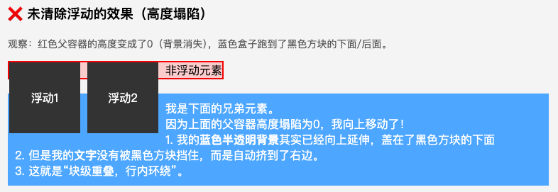

# 浮动

## 浮动导致高度塌陷

当一个元素设置了 `float: left` 或 `float: right` 后，它会脱离正常的文档流。如果父容器内的子元素全部浮动，父容器就无法感知这些子元素的高度，导致高度变为 **0**（即**高度塌陷**），后续元素会"挤"上来占据原位置，造成布局混乱。

<details>
<summary>点击查看折叠的代码</summary>

```html
<!DOCTYPE html>
<html lang="zh-CN">
  <head>
    <meta charset="UTF-8" />
    <title>浮动导致高度塌陷演示</title>
    <style>
      /* 页面基础样式 */
      body {
        font-family: sans-serif;
        padding: 20px;
        background-color: #f4f4f4;
      }

      /*
      【问题源头】父容器
      故意不写 height，依赖子元素撑开高度
    */
      .parent {
        background-color: #ffcccc;
        /* 浅红色背景，方便观察高度 */
        border: 2px solid #ff0000;
        width: 300px;
        /* 注意：这里没有写 height，也没有清除浮动 */
        margin-bottom: 20px;
      }
      /* 浮动的子元素 */
      .box {
        float: left;
        /* 关键：脱离文档流 */
        width: 100px;
        height: 100px;
        background-color: #333;
        color: white;
        text-align: center;
        line-height: 100px;
        margin-right: 10px;
      }

      /*
      【受害元素】父容器后面的兄弟元素
      正常情况下应该在红色盒子下面，但因为红色盒子高度塌陷为0，
      它会跑上去占据位置
    */
      .sibling {
        background-color: #4da6ff;
        color: white;
        padding: 10px;
      }

      h3 {
        margin-top: 0;
      }

      p {
        font-size: 14px;
        color: #555;
      }
    </style>
  </head>

  <body>
    <h3>❌ 未清除浮动的效果（高度塌陷）</h3>
    <p>观察：红色父容器的高度变成了0（背景消失），蓝色盒子跑到了黑色方块的下面/后面。</p>

    <!-- 父容器 -->
    <div class="parent">
      <div class="box">浮动1</div>
      <div class="box">浮动2</div>
      <div class="box2">非浮动元素</div>
      <!-- 父容器只能感知 box2 高度 -->
    </div>

    <!-- 兄弟元素（受害者） -->
    <div class="sibling">
      我是下面的兄弟元素。
      <br />
      因为上面的父容器高度塌陷为0，我向上移动了！
      <br />
      我的内容现在被黑色的浮动块遮挡住了。
    </div>
  </body>
</html>
```
</details>

展示效果：



## 清除浮动

**清除浮动**就是通过 CSS 技巧，强制让父容器"感知"到内部浮动子元素的高度，从而撑开父容器、恢复正常的文档流布局。常见方法有以下四种。

### 方法一：额外标签 + `clear`

在浮动元素的后面添加一个空的块级元素，并设置 `clear: both`。

```css
.clearfix {
  clear: both;
}
```

```html
<div class="parent">
  <div class="child" style="float: left;">内容</div>
  <!-- 添加一个空标签来清除浮动 -->
  <div class="clearfix"></div>
</div>
```

- **缺点**：需要在 HTML 中增加无意义的标签，不符合结构与样式分离的原则，现在较少使用。

### 方法二：触发 BFC（`overflow`）

给父容器设置 `overflow: hidden` 或 `overflow: auto`。

```css
.parent {
  overflow: hidden; /* 或 overflow: auto */
}
```

- **原理**：触发 BFC（块级格式化上下文），在 BFC 中父容器会包含其内部浮动的子元素。
- **缺点**：子元素超出父容器的部分（如下拉菜单、阴影）会被裁剪，可能产生副作用。

### 方法三：伪元素 `::after`（主流）

这是目前最主流、兼容性最好且无需修改 HTML 结构的方法，通常封装为 `.clearfix` 类。

```css
.clearfix::after {
  content: ''; /* 必须生成内容 */
  display: block; /* 转换为块级元素 */
  clear: both; /* 清除左右浮动 */
  visibility: hidden; /* 隐藏元素（可选，防止占位影响） */
  height: 0; /* 高度设为 0 */
}

/* 兼容旧版 IE (IE6/7) */
.clearfix {
  *zoom: 1;
}
```

```html
<div class="parent clearfix">
  <div class="child" style="float: left;">左侧浮动</div>
  <div class="child" style="float: right;">右侧浮动</div>
  <!-- 不需要在 HTML 里加任何额外标签 -->
</div>
```

- **优点**：不污染 HTML 结构，兼容性好，不会产生副作用。

### 方法四：使用 Flexbox 或 Grid

现代布局模型天然不存在浮动塌陷问题，可直接替代浮动布局：

```css
.parent {
  display: flex; /* 或 display: grid */
}
```

- **注意**：这实际上是**替代**浮动布局，而非"清除"浮动。现代开发中能不用 `float` 做布局就尽量不用。

## 为什么背景重叠但文字环绕

浮动元素虽然脱离了文档流（导致父容器高度塌陷），但并没有完全脱离"文字流"：**块级盒子（如 div）会被浮动元素覆盖或挤开，但行内内容（如文字、图片）会主动"环绕"在浮动元素周围。**

### 核心原因：浮动的定义

CSS 规范规定，`float` 的设计初衷就是为了实现"文字环绕图片"的效果（类似报纸排版），其本质是：

> 一个浮动元素会脱离正常的**块级流（Block Flow）**，但它仍然参与**行内流（Inline Flow）**。

因此：

- **块级盒子**：浮动元素脱离文档流，后面的块级元素会忽略它的存在，占据其原本的位置（表现为背景重叠、高度塌陷）。
- **行内内容**：浮动元素不会遮挡行内内容，浏览器会自动计算空间，将文字"挤"到浮动元素的旁边或下方（表现为文字环绕）。

### 布局阶段（Layout / Reflow）

浏览器计算每个元素的几何位置（x, y, width, height）时，对两类内容采用不同逻辑：

- **块级盒子（背景）**：块级布局算法忽略浮动元素，`.sibling` 的边界框被计算到与浮动块重叠的区域。
- **行框（Line Box）**：文字被切割成一个个行框，行框构建时会查询当前行是否有浮动"障碍物"，按 `行框宽度 = 容器宽度 - 浮动宽度` 收缩有效宽度或将行框下移，避开浮动区域。

### 绘制阶段（Paint）

按 CSS 2.1 的绘制顺序：先画普通流块级元素的背景，再画浮动元素，最后画行内内容。但文字之所以不被遮挡，并不是因为它画在浮动块"上面"，而是**根本没画在重叠坐标上**——行框坐标在布局阶段就已被移开。

### 总结

- **高度塌陷 / 背景重叠**：布局阶段块级盒子忽略浮动，坐标发生重叠。
- **文字环绕**：布局阶段行框排除浮动区域，坐标发生避让。

**一句话概括**：在布局（Reflow）阶段，浏览器对块级盒子忽略浮动占位（导致坐标重叠），对行框执行排除浮动区域的几何计算（导致坐标避让）；因此在绘制（Paint）阶段，背景画在了重叠区，文字画在了避让区。
