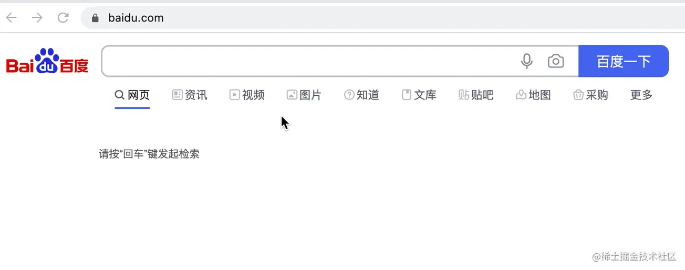
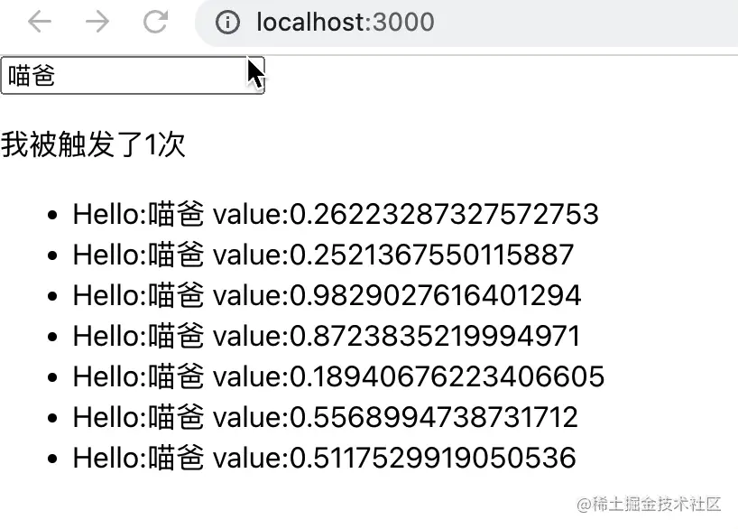

# React.useTransition 与 useDeferredValue

`useTransition` 和 `useDeferredValue` 都是 React 18 引入的**并发特性（Concurrent Features）**，核心目标一致：让 React 优先响应高优先级交互（如输入、点击），将高开销的低优先级更新延迟或中断处理，避免界面卡顿。但两者的控制方式和作用对象有本质区别。

## 一句话总结区别

- **`useTransition`**：**主动触发**——把状态更新包在 `startTransition` 里，React 将其标记为低优先级。适用于按钮点击触发的耗时操作。
- **`useDeferredValue`**：**被动延迟**——传入一个高频变化的值（如输入框内容），返回它的“延迟副本”。适用于输入框实时过滤列表。

| | `useTransition` | `useDeferredValue` |
|------|------|------|
| 控制方式 | 主动包裹 `startTransition` | 自动延迟某个值 |
| 作用对象 | 状态更新逻辑本身 | 具体值的“延迟副本” |
| `isPending` | ✅ 可用于 loading 提示 | ❌ 无 |
| 适用操作 | 按钮点击、切换标签等离散操作 | 输入框、滑块等连续输入 |
| 代码位置 | 事件处理函数中 | 组件 render 逻辑中 |

---

## useTransition：主动标记“这个更新不紧急”

把非紧急的 `setState` 包在 `startTransition` 回调中，React 会先响应用户输入，空闲时再处理这些更新；期间可通过 `isPending` 显示轻量 loading。

```jsx
const [isPending, startTransition] = useTransition();
const [tab, setTab] = useState('all');

const handleTabChange = (newTab) => {
  setTab(newTab); // 高优先级：立即更新

  startTransition(() => {
    // 低优先级：耗时的列表过滤推迟处理
    setFilteredItems(expensiveFilter(newTab));
  });
};

return (
  <div>
    <button onClick={() => handleTabChange('active')}>Active</button>
    {isPending && <Spinner />} {/* 可选：显示 loading */}
    <ItemList items={filteredItems} />
  </div>
);
```

注意事项：

- `startTransition` 只影响**同步的状态更新**，包裹异步操作（如 API 调用）无效；结合数据请求需配合 `Suspense` + 缓存。
- 不要用于表单提交、按钮即时反馈等紧急更新。

---

## useDeferredValue：被动延迟某个值

传入高频变化的值，返回其延迟版本。原始值快速变化时，延迟值会“滞后”，避免下游组件频繁重渲染——类似自动防抖，但由 React 调度器管理。

典型场景：输入框实时搜索。用户连续输入时，中间态会触发大量无用的计算/请求，利用 `useDeferredValue` 降低其优先级。



```jsx
function App() {
  const [text, setText] = useState('');
  const deferredText = useDeferredValue(text);

  const handleChange = (e) => {
    setText(e.target.value); // 输入框立即响应
  };

  return (
    <div className="App">
      <input value={text} onChange={handleChange} />
      <List text={deferredText} /> {/* 列表使用延迟值，不会每次输入都重算 */}
    </div>
  );
}
```

配合 `useMemo` 缓存过滤结果，依赖延迟值而非原始值：

```jsx
const filteredList = useMemo(
  () => list.filter(item => item.includes(deferredText)),
  [deferredText]
);
```

效果：输入流畅不卡顿，列表在浏览器空闲时更新。



---

## 场景选择指南

- **用 `useTransition`**：点击“搜索”按钮后过滤、切换标签页加载新数据——需要明确控制更新时机，或需要 `isPending` 提示。
- **用 `useDeferredValue`**：输入框打字实时过滤（防抖效果）、拖动滑块实时预览——高频连续变化，无需 loading 提示。

两者可组合：先用 `useDeferredValue` 获取稳定查询词，再用 `startTransition` 触发涉及 `Suspense` 的搜索更新。
