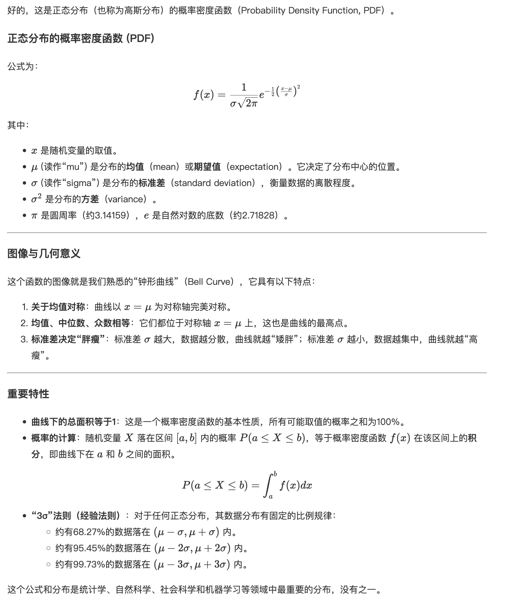

# Vue 3 展示 Markdown 与流式文本

环境为 Vue 3 + Vite + TypeScript。使用 markdown-it 解析 Markdown、highlight.js 高亮代码、KaTeX 渲染数学公式；两种公式插件共用渲染组件。

## 安装依赖

以下默认使用 `markdown-it-texmath`。

```bash
npm install markdown-it markdown-it-anchor markdown-it-texmath highlight.js katex
npm install -D @types/markdown-it @types/katex
```

如果公式插件缺少类型声明，可在项目的 `.d.ts` 文件中补充 `declare module 'markdown-it-texmath';`。

## 共用解析器

```ts
// src/components/markdown.ts
import MarkdownIt from 'markdown-it';
import anchor from 'markdown-it-anchor';
import texmath from 'markdown-it-texmath';
import katex from 'katex';
import hljs from 'highlight.js';
import 'highlight.js/styles/github.css';
import 'katex/dist/katex.min.css';

const md: MarkdownIt = new MarkdownIt({
  html: false,
  linkify: true,
  typographer: true,
  highlight(code, language) {
    if (language && hljs.getLanguage(language)) {
      try { return hljs.highlight(code, { language }).value; }
      catch { /* 回退到转义后的代码。 */ }
    }
    return md.utils.escapeHtml(code);
  }
});
md.use(anchor);
md.use(texmath, {
  engine: katex,
  delimiters: 'dollars',
  katexOptions: { macros: { '\\RR': '\\mathbb{R}' } }
});

export default md;
```

`html: false` 表示不解析输入中的原始 HTML。确实需要渲染外部 HTML 时，应在写入 `v-html` 前清洗内容。

## 共用 Vue 组件

Vue 的 `v-html` 直接接收 HTML 字符串，无需 React 风格的 `{ __html }` 包装。

```vue
<!-- src/components/MarkdownContent.vue -->
<script setup lang="ts">
import { computed } from 'vue';
import md from './markdown';

const props = withDefaults(defineProps<{ content?: string }>(), { content: '' });
const html = computed(() => md.render(props.content));
</script>

<template>
  <div class="markdown-content" v-html="html" />
</template>

<style scoped>
.markdown-content { line-height: 1.8; overflow-wrap: anywhere; }
.markdown-content :deep(pre) { padding: 12px; overflow-x: auto; background: #f6f8fa; }
.markdown-content :deep(img) { max-width: 100%; }
.markdown-content :deep(table) { border-collapse: collapse; }
.markdown-content :deep(th),
.markdown-content :deep(td) { border: 1px solid #ddd; padding: 8px; }
</style>
```

```vue
<script setup lang="ts">
import MarkdownContent from '@/components/MarkdownContent.vue';
const content = String.raw`# 公式示例

行内公式：$E = mc^2$

$$f(x) = \frac{1}{\sigma\sqrt{2\pi}} e^{-\frac{(x-\mu)^2}{2\sigma^2}}$$`;
</script>

<template>
  <MarkdownContent :content="content" />
</template>
```

该示例包含标题、行内公式与块级公式。

## 替换公式插件

也可使用 `@vscode/markdown-it-katex`，只替换解析器中的公式插件，组件与使用方式保持共用。

```bash
npm install @vscode/markdown-it-katex
```

```ts
import markdownItKatex from '@vscode/markdown-it-katex';

// 替换 texmath 的 import 与 md.use(texmath, ...)；不要同时注册两个公式插件。
md.use(markdownItKatex, { katex });
```

需要复制公式或化学表达式时，可按需求加载 `katex/contrib/copy-tex`、`katex/contrib/mhchem`。



## fetch 接收 SSE 并更新 Markdown

下面假设后端返回 `text/event-stream`，每个事件的 `data:` 是文本增量。读取到的网络块不一定是完整事件，必须先缓冲，再按空行拆分。

```vue
<script setup lang="ts">
import { onUnmounted, ref } from 'vue';
import MarkdownContent from '@/components/MarkdownContent.vue';

const text = ref('');
let activeRequest: AbortController | undefined;
onUnmounted(() => activeRequest?.abort());

async function question() {
  activeRequest?.abort();
  const controller = new AbortController();
  activeRequest = controller;
  text.value = '';
  let reader: ReadableStreamDefaultReader<Uint8Array> | undefined;

  try {
    const response = await fetch('/api/chat/stream', {
      method: 'POST',
      headers: { 'Content-Type': 'application/json' },
      body: JSON.stringify({ messages: [{ role: 'user', content: '解释 Vue 的响应式' }], stream: true }),
      signal: controller.signal
    });
    if (!response.ok || !response.body) throw new Error(`HTTP ${response.status}`);
    reader = response.body.getReader();
    const decoder = new TextDecoder();
    let buffer = '';

    while (true) {
      const { done, value } = await reader.read();
      if (controller.signal.aborted) return;
      buffer += done ? decoder.decode() : decoder.decode(value, { stream: true });
      let boundary: RegExpMatchArray | null;
      while ((boundary = buffer.match(/\r?\n\r?\n/))) {
        const index = boundary.index!;
        const event = buffer.slice(0, index);
        buffer = buffer.slice(index + boundary[0].length);
        const lines = event.split(/\r?\n/).filter(line => line.startsWith('data:'));
        if (!lines.length) continue;
        const data = lines.map(line => line.slice(5).replace(/^ /, '')).join('\n');
        if (data === '[DONE]') {
          await reader.cancel();
          return;
        }
        text.value += data;
      }
      if (done) break;
    }
  } catch (error) {
    if (!controller.signal.aborted) console.error(error);
  } finally {
    reader?.releaseLock();
    if (activeRequest === controller) activeRequest = undefined;
  }
}
</script>

<template>
  <button @click="question">获取流式内容</button>
  <MarkdownContent :content="text" />
</template>
```

如果后端的 data 是 JSON，应先解析再提取文本字段，不能直接当 Markdown 拼接。此示例不实现 SSE 自动重连；流结束时没有空行结尾的不完整事件不会提交。频繁增量更新时，可按需求合并渲染批次。

参考：[markdown-it](https://github.com/markdown-it/markdown-it)、[markdown-it-texmath](https://github.com/goessner/markdown-it-texmath)。
