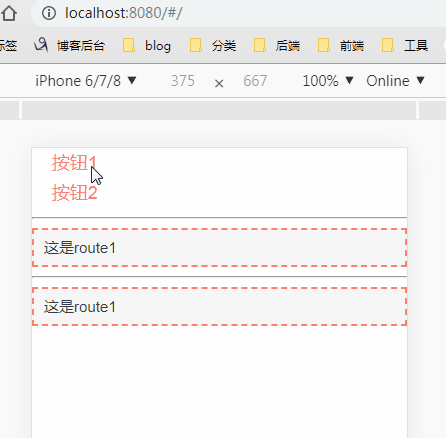

# 路由过渡动画

以下使用 Vue 3 + Vue Router 4，通过 RouterView 插槽为实际页面组件添加过渡。

```vue
<template>
  <nav>
    <RouterLink to="/">首页</RouterLink>
    <RouterLink to="/detail">详情</RouterLink>
  </nav>
  <RouterView v-slot="{ Component }">
    <Transition name="slide" mode="out-in">
      <component :is="Component" />
    </Transition>
  </RouterView>
</template>

<style>
.slide-enter-active,
.slide-leave-active { transition: opacity 0.3s, transform 0.3s; }
.slide-enter-from { opacity: 0; transform: translateX(50%); }
.slide-leave-to { opacity: 0; transform: translateX(-50%); }
</style>
```

- `mode="out-in"` 让旧页面先离开，新页面再进入。
- 需要同一路由不同参数之间也触发过渡时，可给动态组件增加与参数对应的 key。
- 反向滑动可使用另一个过渡 name，并交换进入、离开的 transform 方向。
- Vue 2 的进入起点类名为 `*-enter`；Vue 3 改为 `*-enter-from`。样式可按类选择器书写，无需只使用标签名。



单元素与列表过渡见 [内置组件](../020-内置组件.md)。
