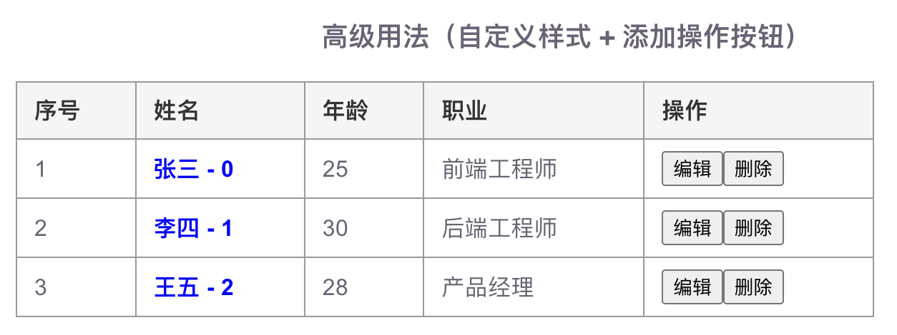

```html
<!-- 组件 -->
<template>
  <div>
    <h1>my-template 组件</h1>
    <slot></slot>
    <slot name="slotname"></slot>
  </div>
</template>
```

## 匿名插槽

```html
<my-template>
  <p>这是匿名插槽的内容</p>
</my-template>
```

## 具名插槽

```html
<my-template>
  <p solt="slotname">这是具名插槽的内容</p>
</my-template>
```

## 作用域插槽

```html
<template>
  <div style="padding: 20px">
    <!-- 场景二：高级用法（自定义样式 + 操作按钮） -->
    <h3>高级用法（自定义样式 + 添加操作按钮）</h3>
    <CustomTable :tableData="users">
      <!-- 
        1. 默认插槽 (对应姓名列)
        我们可以选择只覆盖姓名，也可以覆盖整行。
        这里为了演示灵活性，我们只覆盖姓名，年龄和职业保持子组件的默认输出。
      -->
      <template #default="{ row, index }">
        <!-- 姓名：蓝色加粗 -->
        <strong style="color: blue; font-size: 16px">{{ row.name }} - {{ index }}</strong>
      </template>

      <!-- 
        2. 年龄列自定义 (如果需要修改年龄样式)
        注意：子组件目前硬编码了年龄列。如果要完全自定义年龄，
        需要在子组件中为年龄也提供一个 slot。
        
        *为了简化，我们假设年龄和职业不需要特殊样式，只显示在第二、三列。*
      -->

      <!-- 
        3. 操作列 (对应操作列)
        这个插槽会被渲染到 <td v-if="$slots.action"> 中
      -->
      <template #action="{ row, index }">
        <button
          class="btn"
          @click="handleEdit(row, index)"
        >
          编辑
        </button>
        <button
          class="btn btn-delete"
          @click="handleDelete(row, index)"
        >
          删除
        </button>
      </template>
    </CustomTable>
  </div>
</template>

<script setup>
import { ref } from 'vue';
import CustomTable from './CustomTable.vue';

const users = ref([
  { name: '张三', age: 25, job: '前端工程师' },
  { name: '李四', age: 30, job: '后端工程师' },
  { name: '王五', age: 28, job: '产品经理' },
]);

const handleEdit = (row, index) => {
  console.log('编辑:', row.name, '索引:', index);
};

const handleDelete = (row, index) => {
  console.log('删除:', row.name, '索引:', index);
};
</script>
```

```html
<!-- CustomTable.vue -->
<template>
  <div class="table-container">
    <table class="custom-table">
      <thead>
        <tr>
          <th>序号</th>
          <th>姓名</th>
          <th>年龄</th>
          <th>职业</th>
          <!-- 如果父组件提供了操作列插槽，这里预留表头位置 -->
          <th v-if="$slots.action">操作</th>
        </tr>
      </thead>
      <tbody>
        <tr
          v-for="(row, index) in tableData"
          :key="index"
        >
          <td>{{ index + 1 }}</td>
          <td>
            <!-- 
              核心：作用域插槽
              :row="row" 把整行数据传出去
              :$index="index" 把索引传出去（可选）
            -->
            <slot
              :row="row"
              :index="index"
            >
              <!-- 默认 fallback：如果没有自定义内容，显示原始文本 -->
              {{ row.name }} - {{ row.age }} - {{ row.job }}
            </slot>
          </td>

          <!-- 
             注意：为了让“年龄”和“职业”列在视觉上独立，
             我们可以在 td 里再次嵌套 slot，或者让父组件一次性渲染整行。
          -->
          <td>{{ row.age }}</td>
          <td>{{ row.job }}</td>

          <!-- 操作列：如果父组件传入了 action 插槽，则显示按钮 -->
          <td v-if="$slots.action">
            <slot
              name="action"
              :row="row"
              :index="index"
            ></slot>
          </td>
        </tr>
      </tbody>
    </table>
  </div>
</template>

<script setup>
defineProps({
  tableData: {
    type: Array,
    required: true,
  },
});
</script>

<style scoped>
.table-container {
  margin: 20px 0;
  font-family: Arial, sans-serif;
}

.custom-table {
  border-collapse: collapse; /* 关键：合并边框，否则会有双重线 */
  width: 100%;
  max-width: 600px;
  border: 1px solid #999;
}

.custom-table th,
.custom-table td {
  border: 1px solid #999; /* 单元格边框 */
  padding: 8px 12px;
  text-align: left;
  vertical-align: middle;
}

.custom-table th {
  background-color: #f5f5f5;
  font-weight: bold;
  color: #333;
}

/* 模拟截图中的按钮样式 */
.btn {
  padding: 4px 8px;
  margin-right: 5px;
  border: 1px solid #ccc;
  background: #fff;
  cursor: pointer;
  border-radius: 3px;
  font-size: 12px;
}

.btn:hover {
  background: #eee;
}

.btn-delete {
  color: red;
  border-color: #ffcccc;
}
</style>
```

显示结果：


