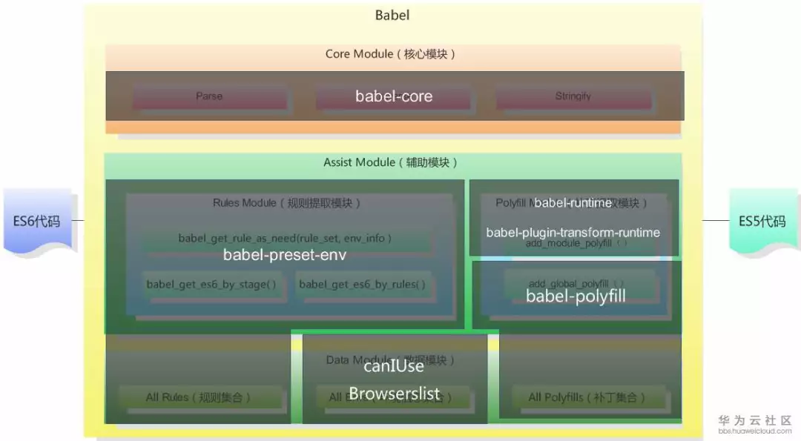

# Babel

Babel 是一个广泛使用的 JavaScript 编译器，主要用于将 ECMAScript 2015+ 的新特性编译为向后兼容的 JavaScript 代码，以便在当前和旧版本的浏览器或环境中运行。它不仅可以编译新语法，还可以配合 polyfill 支持新的内置方法（如 `Object.assign`、`Array.from`）和新的 API（如 Promise、Generator）。

Babel 是一个模块化的工具，可以通过插件来扩展功能，从而实现各种不同的转换和处理。

## 参考资料

- [Babel 中文网](https://www.babeljs.cn/)
- [关于 Babel 你必须知道的](https://mp.weixin.qq.com/s?__biz=MzAxODE2MjM1MA==&mid=2651556802&idx=1&sn=e1662ecf90a83b1af70f414a129c419e&chksm=80255c03b752d515cd295494b7dd7f9934dda965993ceb504dd81883986b2459ba6bbc8036c1&scene=21#wechat_redirect)
- [如何写好 .babelrc？Babel 的 presets 和 plugins 配置解析](https://mp.weixin.qq.com/s?__biz=MzAxODE2MjM1MA==&mid=2651554316&idx=2&sn=0eed97d38b8e52bd32e3a983e4a36259&chksm=802555cdb752dcdbfb0d7943f4b16013478f3876323d3c0b249f7e840dfc32ff7f8d42de900f&scene=21#wechat_redirect)
- [不容错过的 Babel 7 知识汇总](https://mp.weixin.qq.com/s?__biz=MzAxODE2MjM1MA==&mid=2651557504&idx=1&sn=d107ac3ffcf0b1e7703f67841e6878e3&chksm=80255941b752d057bdee60ab26fbb881f59c64e7748d23b00a55498009c82462e267701f1884&mpshare=1&scene=1&srcid=&sharer_sharetime=1575690524256&sharer_shareid=38ae308f973ffdefaa3c22ddb4d38578&key=636b949d6534501af93901af2df27754f02c01fd0f6d1dff0c825d8b867aa2769c6cf15ca179ae9223091e6e5ee474da1b15dd0dc957ace5d853f8d0c8420acaad099c6ac4c728adaf5a77a274936c9a&ascene=1&uin=Mjg1MDc1OTkwNQ%3D%3D&devicetype=Windows+7&version=62070158&lang=zh_CN&exportkey=A5kS66nATzTigVUVtTZ4aMs%3D&pass_ticket=ng4r6Ujr5n0DdvPEeoEsrvf9%2FfCrg4c8eOArZ6jPtCc9NL9NVrvBFQDlGlgHNG87)
- [一口（很长的）气了解 babel](https://zhuanlan.zhihu.com/p/43249121)
- [core-js@3 带来的惊喜](https://www.cnblogs.com/sefaultment/p/11631314.html)
- [babel 7 的使用的个人理解](https://www.jianshu.com/p/cbd48919a0cc)

## 编译流程

Babel 编译经历三个阶段：解析（parse）、转换（transform）、生成（generate）。


注意：在升级到 Babel 6.X 版本以后，所有的插件都是可插拔的（**意味着 transform 流程全部交给了插件去做**）。这就意味着只安装 Babel 是不能工作的，需要配置对应的 `.babelrc` 文件才能发挥完整的作用。

## 插件（plugin）

Plugin 是单个的转换器，每个插件通常只负责一个特定的转换规则，用户可以根据需求选择性地启用或禁用插件，并通过配置插件的选项来自定义转换行为。

插件分为两种：

### 语法插件

只允许 Babel **解析（parse）** 特定类型的语法（不进行转换）。

### 转换插件

将不识别的新内置函数进行转换。转换插件会启用相应的语法插件（因此不需要同时指定这两种插件）。

### 示例：将箭头函数转换为普通函数

在 `.babelrc` 中设置：

```json
{
  "plugins": ["@babel/plugin-transform-arrow-functions"]
}
```

转换前：

```javascript
const name = 'houfee';
let hello = `hello ${name}`;

let func = () => {
  console.log('转化箭头函数');
};
```

转换后：

```javascript
const name = 'houfee';
let hello = `hello ${name}`;

let func = function () {
  console.log('转化箭头函数');
};
```

**可见，以上转换只转换了箭头函数，而 `const` 和 `let` 却没有转换。**

### 常用插件

1. `@babel/plugin-transform-arrow-functions`：将箭头函数转换为普通函数。
2. `@babel/plugin-transform-classes`：转换 ES6 类语法。
3. `@babel/plugin-transform-template-literals`：转换模板字面量。
4. `@babel/plugin-transform-block-scoping`：转换块作用域。
5. `@babel/plugin-transform-destructuring`：转换解构语法。
6. `@babel/plugin-transform-async-to-generator`：将 async/await 转换为生成器函数。
7. `@babel/plugin-transform-regenerator`：为 async/await 添加支持。
8. `@babel/plugin-transform-runtime`：使用 Babel 提供的运行时来避免编译输出中的重复代码。
9. `@babel/plugin-proposal-object-rest-spread`：转换对象的扩展运算符。
10. `@babel/plugin-proposal-class-properties`：转换类属性语法。
11. `@babel/plugin-syntax-dynamic-import`：支持动态导入语法。
12. `@babel/plugin-transform-react-jsx`：转换 JSX 语法。
13. `@babel/plugin-transform-react-display-name`：自动添加 React 组件的 displayName。
14. `@babel/plugin-transform-react-constant-elements`：优化 React 组件的不变元素。

## 预设（preset）

Preset 是预设的转换器集合，包含一组预定义的转换规则，可以一次性地将代码转换成某个特定环境所需要的语法。Babel 将 ES6+ 新语法封装为多个插件，而不是唯一一个插件。

要体验 ES6 所有新特性（**注意：语法转换只是将高版本的语法转换成低版本的，但是新的内置函数、实例方法无法转换**），只需在 `.babelrc` 中设置：

```json
{
  "presets": ["@babel/preset-env"]
}
```

转换前：

```javascript
const name = 'houfee';

let hello = `hello ${name}`;

let func = () => {
  console.log('转化箭头函数');
};

class Point {
  constructor(x, y) {
    this.x = x;
    this.y = y;
  }
}

let promise = new Promise((res, rej) => console.log(res, rej));
```

转换后：

```javascript
"use strict";

function _classCallCheck(instance, Constructor) { if (!(instance instanceof Constructor)) { throw new TypeError("Cannot call a class as a function"); } }

var name = 'houfee';
var hello = "hello ".concat(name);

var func = function func() {
  console.log('转化箭头函数');
};

var Point = function Point(x, y) {
  _classCallCheck(this, Point);

  this.x = x;
  this.y = y;
};

var promise = new Promise(function (res, rej) {
  return console.log(res, rej);
});
```

**可见：`@babel/preset-env` 只转换了已存在的语法，对于新增的内置函数依然是无法转换的。**

### 常见预设

1. `@babel/preset-env`：官方预设，根据配置的目标环境（浏览器或 Node.js 版本）自动确定所需的转换规则。
2. `@babel/preset-react`：处理 React 应用中的 JSX 语法和相关转换规则。
3. `@babel/preset-typescript`：处理 TypeScript 代码的转换。
4. `@babel/preset-flow`：处理 Flow 静态类型检查器的代码。

## 插件和预设的区别

1. **粒度不同**：presets 是一组转换规则的集合，而 plugins 是单个转换规则的实现。
2. **使用方式不同**：presets 可以一次性地应用一组转换规则，而 plugins 需要根据需求逐个添加和配置。
3. **适用场景不同**：presets 适合快速配置常见的转换需求，而 plugins 适合精细控制转换过程，或者应用一些特定的转换规则。

## 执行顺序

多个 plugin 和 preset 同时存在时，执行顺序非常重要：

1. 先执行完所有 plugin，再执行 preset；
2. 多个 plugin，按照声明次序顺序执行；
3. 多个 preset，按照声明次序逆序执行。

## polyfill

在 Babel 中，Polyfill 是指用于实现浏览器不支持的 JavaScript 特性或 API 的代码填充（Shim）：

1. **解决兼容性问题**：不同浏览器或环境对 JavaScript 新特性的支持程度不同，使用 Polyfill 可以在旧环境中使用新特性；
2. **填充缺失的 API**：通过 Polyfill 在旧浏览器中模拟实现 `Promise`、`Array.from` 等新增的标准 API。

常见 Polyfill：

1. `core-js`：非常常见的 Polyfill 库，提供大量标准 JavaScript API 的实现，包括对新的 ECMAScript 版本的支持。
2. `regenerator-runtime`：用于支持 generator 函数和 async/await，是 Babel 编译 async/await 代码时依赖的运行时支持。
3. `es6-promise`：为不支持 Promise 的旧浏览器提供 Promise 支持。
4. `fetch`：为不支持 fetch API 的旧浏览器提供网络请求支持。

### @babel/polyfill

Babel 对一些新的 API 是无法转换的，比如 `Generator`、`Set`、`Proxy`、`Promise` 等全局对象，以及 `includes`、`Array.from` 等新增方法，这时就需要 polyfill 来做兼容。

官网的定义：`@babel/polyfill` 是为了模拟一个完整的 ES6+ 环境，旨在用于应用程序而不是库/工具。

`@babel/polyfill` 主要有两个缺点：

1. 会导致打出来的包非常大，很多其实没有用到，对资源来说是一种浪费；
2. 可能会污染全局变量，给很多类的原型链上都作了修改，存在不可控因素。

因为上面两个问题，Babel 7 通过设置 `"useBuiltIns": "usage"` 参数就可以实现按需加载。

## 相关模块

Babel 的模块那么多，要怎么学习呢？



目前 Babel 版本为 Babel 7.4.0，此图只是示意（网图）。

### 核心库 `@babel/core`

Babel 的核心 API 都在这个模块中。这个模块会把我们写的 JS 代码抽象成 AST（abstract syntax tree）树，然后再将 plugins 转译好的内容解析为 JS 代码。

### 命令行工具 `@babel/cli`

Babel 提供的命令行工具，主要提供 `babel` 这个命令，适合安装在项目里。

`@babel/node` 提供了 `babel-node` 命令，更适合全局安装，不适合安装在项目里。

```bash
npm install --save-dev @babel/core @babel/cli
```

### `@babel/preset-env`

将新增的 ES6 语法转换为浏览器支持的语法，但不会转换新增的内置函数。

### `@babel/polyfill`

为浏览器做新 API 的兼容，模拟完整的 ES6+ 环境（详见上文 polyfill 一节）。

### `@babel/plugin-transform-runtime`

配合其他插件使用，避免编译后的代码中出现重复的辅助函数，有效减少包体积。
