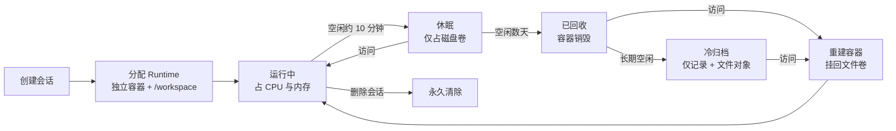

# WorkBuddy 会话与执行环境机制

> **范围**：桌面端两种工作空间的执行模型 —— 远程空间（云端沙箱）与本地文件夹（本机执行）。
>
> **内容**：执行环境位置、创建与回收、重开恢复路径、持久化边界、资源模型。

---

## 摘要

- **远程空间** = 按会话分配的隔离沙箱容器（官方术语 `Runtime`），随时间分级降级：运行 → 休眠 → 回收 → 冷归档。
- **本地文件夹** = 你电脑上的一个会话进程，不存在沙箱生命周期。
- 两种模式下**对话历史与工作区文件都持久**。差别在于：容器里临时安装的东西会不会丢、机器在不在。
- 唯一不可恢复的操作是**手动删除会话**；归档不影响数据。

---

## 1. 概念模型

| 概念                      | 定义                                                                    | 类比           |
| ------------------------- | ----------------------------------------------------------------------- | -------------- |
| **Session（会话）**       | 一次对话的完整上下文：消息历史、文件、产出物                            | 一次会议记录   |
| **Runtime（运行时）**     | Session 背后真正运行的**独立云端沙箱容器**，含完整 Linux 文件系统与终端 | 一间会议室     |
| **Workspace（工作空间）** | 挂载进沙箱的目录，映射到容器内 `/workspace/<名字>/`                     | 会议室的资料柜 |

一个 Runtime 承载一个或多个 Session，**通常一一对应**；创建 Runtime 时自动创建初始 Session。

---

## 2. 两种执行环境对照

| 维度       | 远程空间                         | 本地文件夹           |
| ---------- | -------------------------------- | -------------------- |
| 计算发生在 | 腾讯云隔离容器                   | 你自己的电脑         |
| 环境形态   | 容器实例                         | 本机会话进程         |
| 持久化载体 | `/workspace` 持久卷 + 对象存储   | 你的磁盘             |
| 空闲处理   | 10 分钟休眠，数天后回收          | 进程常驻，心跳维持   |
| 重开耗时   | 秒级 \~ 一分钟（取决于闲置时长） | 秒级（仅重启进程）   |
| 换设备     | ✅ 可接上                        | ❌ 接不上            |
| 关机后     | ✅ 任务继续跑                    | ❌ 中断              |
| 主要风险   | 会话被回收、依赖丢失             | 目录被移动、磁盘增长 |

---

## 3. 远程空间（云端沙箱）

### 3.1 状态机



执行链路：建会话 → 调度器拉起容器（冷启动：拉镜像、挂卷）→ 注入上下文（消息、文件、技能、连接器凭证）→ Agent 主循环（思考 → 调工具 → 读结果，工具真实运行在沙箱内）→ 产物写回 `/workspace` 并同步到结果区。

### 3.2 四阶段明细

| 阶段       | 触发条件       | 容器           | 保留内容            | 资源成本         |
| ---------- | -------------- | -------------- | ------------------- | ---------------- |
| **运行中** | 正在执行       | 存在           | 内存态 + 磁盘全部   | 高（CPU + 内存） |
| **休眠**   | 空闲约 10 分钟 | 暂停，内存换出 | 磁盘卷完整保留      | 中（磁盘）       |
| **已回收** | 空闲数天以上   | **已销毁**     | 快照 / 对象存储     | 低               |
| **冷归档** | 数月到一年     | 不存在         | 会话记录 + 文件对象 | 极低             |

官方文档给出的沙箱状态有三种表述：**运行中**（正在活跃服务）、**休眠**（空闲超时自动暂停，再次访问自动唤醒）、**失败**（创建或启动异常）。

> **关键区分**：一年未打开的会话**不处于「休眠」状态**。它的容器早已回收，平台侧只剩「一条数据库记录 + 对象存储里的文件」，访问时才重建容器。

### 3.3 持久化边界

这是最容易被误判的一点：**只有 `/workspace` 是持久卷，容器系统层不持久。**

| 内容                                 | 隔数天后 | 隔数月后 |
| ------------------------------------ | -------- | -------- |
| `/workspace` 内的文件、产物、代码    | ✅ 在    | ✅ 在    |
| 对话历史（服务端数据库）             | ✅ 在    | ✅ 在    |
| `pip install` / `apt install` 装的包 | ❌ 丢失  | ❌ 丢失  |
| 全局配置、临时环境变量               | ❌ 丢失  | ❌ 丢失  |

典型症状：**文件都在，但脚本一跑就报 `ModuleNotFoundError`。**

对策是把依赖清单纳入 workspace，重开后一条命令恢复：

```bash
pip install -r requirements.txt   # 或 npm install / pnpm install
```

**一定会中断的两类东西：**

1. **正在跑的长任务** —— 休眠时进程被中止，不会「醒来接着跑」。长任务应在单次会话内完成。
2. **后台服务与定时任务** —— 会话沙箱是「跑完就睡」，不是常驻服务器。需要 7×24 在线的场景应用云服务（应用托管）。

### 3.4 隔离模型

- 每个 Session 一个独立 Runtime，**独立对话历史 + 独立文件存储**。
- 会话之间看不到彼此的 `/workspace`；安装的包、临时文件、环境变量互不串扰。
- 共用的是**底层物理集群**（容器编排），不是执行环境本身。一个集群跑十万个会话，就是十万个互不可见的容器。

### 3.5 资源模型与成本

**三个杠杆：**

1. **休眠即让位（最大杠杆）** —— 空闲 10 分钟自动休眠，同刻真正占内存的只是正在跑的一小批。这是「池化 + 挂起」，不是「一人一台」。
2. **配额隔离** —— 每个沙箱有独立 CPU / 内存上限，单个会话跑爆是自己 OOM，不影响邻居。
3. **弹性调度 + 排队** —— 按节点剩余资源分配，不足则扩容，满则排队；唤醒时先重建容器再挂回卷。

**为什么必须回收：**

| 假设                    | 换算          | 成本量级                         |
| ----------------------- | ------------- | -------------------------------- |
| 10 万容器 × 512 MB 内存 | 51 TB 内存    | 约 150 万/月（按 1 GB ≈ ¥30/月） |
| 10 万会话 × 50 MB 文件  | 5 TB 对象存储 | 低两三个数量级                   |

内存比磁盘贵两三个数量级，因此「让所有历史会话常驻内存」在架构上不可行 —— 这是物理约束，不是优化选项。

---

## 4. 本地文件夹（本机执行）

### 4.1 执行栈

| 层               | 作用                              |
| ---------------- | --------------------------------- |
| WorkBuddy 客户端 | 常驻，负责调度与界面              |
| **会话进程**     | **即执行环境**，独立 `pid` + 心跳 |
| 本地文件夹       | Agent 真实读写，不经上传          |
| `workbuddy.db`   | 对话历史与状态落本地              |
| 云端             | 只负责模型推理                    |

执行链路：建会话（在 `workbuddy.db` 落记录，绑定目录路径为 `cwd`）→ 拉起或复用本机进程（含 `prewarm` 预热进程）→ 直接在目录内读写（无上传/下载环节）→ 起子进程执行（python / node / git / ffmpeg）→ 产物直接落盘。

### 4.2 实测数据

来自一台运行中的 macOS 机器（Darwin arm64）：

| 实测项         | 结果                                                                   |
| -------------- | ---------------------------------------------------------------------- |
| 会话记录字段   | `pid`、`cwd`、`startedAt`、`lastHeartbeat`、`kind`                     |
| 会话类型       | `interactive`（交互）与 `prewarm`（预热）                              |
| 心跳           | 秒级刷新                                                               |
| 会话数据       | `~/.workbuddy/sessions/*.json`                                         |
| 对话历史       | `~/.workbuddy/workbuddy.db`（SQLite + WAL）                            |
| 状态目录总占用 | `~/.workbuddy` **2.0 GB**（logs 402 MB、projects 29 MB、traces 18 MB） |

**每个会话 = 一个本机进程（`pid`）+ 一个工作目录（`cwd`）+ 一条心跳。** 这就是本地模式「执行环境」的真实形态。

### 4.3 持久化边界

全持久。文件系统、Python / Node、venv、`node_modules`、系统工具都在磁盘上，**不随时间丢失**。重开只需「重启进程」，不涉及环境重建 —— 没有冷启动，也不需要重新装依赖。

### 4.4 四个真实代价

1. **路径依赖脆弱** —— 工作目录被改名或移动，会话即丢失路径。这是本地模式最常见的事故。
2. **磁盘持续增长** —— 实测 2.0 GB，日志占大头。需定期清理 logs 与 traces。
3. **关机即停** —— 系统休眠或合盖，正在跑的任务中断，没有云端接管。
4. **无硬隔离** —— 本地的「沙箱」只是**权限边界**（限制在 workspace 内、高风险操作需确认），不是容器；安装的东西会留在你机器上。缓解：WorkBuddy 优先使用托管的 Python / Node 运行时（`~/.workbuddy/binaries`），不污染系统环境。

---

## 5. 操作语义（两种模式通用）

| 操作           | 远程空间                   | 本地文件夹                 |
| -------------- | -------------------------- | -------------------------- |
| 切换到别的会话 | 原沙箱转休眠               | 进程常驻，仅切换上下文     |
| 关闭再打开     | 已休眠或已回收，首次需等待 | 进程被终止，重开时重新拉起 |
| 换设备登录     | 同一个沙箱，直接接上       | 接不上（数据在本机）       |
| **删除会话**   | **永久清除**               | 文件仍在磁盘，会话记录清除 |
| 归档会话       | 移出列表，数据保留         | 移出列表，数据保留         |

**无论哪种模式，文件与对话历史都不会因为「关了」而消失。** 判断沙箱冷热的方式很简单：打开得越快，容器越热。

---

## 6. 事实分级

| 内容                                  | 依据                                          |
| ------------------------------------- | --------------------------------------------- |
| 独立沙箱、完整 Linux 文件系统与终端   | ✅ 官方文档原文                               |
| Session 与 Runtime 通常一一对应       | ✅ 官方文档原文                               |
| 空闲 10 分钟自动休眠、访问自动唤醒    | ✅ 官方文档原文                               |
| 每个 Session 独立对话历史与文件存储   | ✅ 官方文档原文                               |
| 删除 Session 永久清除对话记录和文件   | ✅ 官方文档原文                               |
| 本地模式：每会话一个本机进程 + 心跳   | ✅ 本机实测（`~/.workbuddy/sessions/*.json`） |
| 本地模式：对话历史存于 `workbuddy.db` | ✅ 本机实测                                   |
| 本地模式：依赖与文件不随时间丢失      | ✅ 由「数据在本机磁盘」必然推出               |
| 数天后容器回收、转快照 / 冷存储       | ⚠️ 官方未逐年写明，按云沙箱通行实现推断       |
| 只有 `/workspace` 持久、系统层不持久  | ⚠️ 按容器存储通行约定推断，实际会遇到         |
| 单沙箱内存规格、扩容策略、调度算法    | ⚠️ 内部实现未公开，方向可信，具体数字不作准   |

> 账号级保留期限以会员条款与页面最新提示为准。

---

## 参考

- [WorkBuddy 简介](https://www.workbuddy.cn/docs/workbuddy/Overview)
- [创建任务](https://www.workbuddy.cn/docs/workbuddy/Create-Task)
- [任务管理](https://www.workbuddy.cn/docs/workbuddy/Task-Management)
- [企业智能体（Runtime / Session 概念）](https://www.workbuddy.cn/docs/workbuddy/From-Beginner-to-Expert-Guide/Function-Description/CloudAgent)
