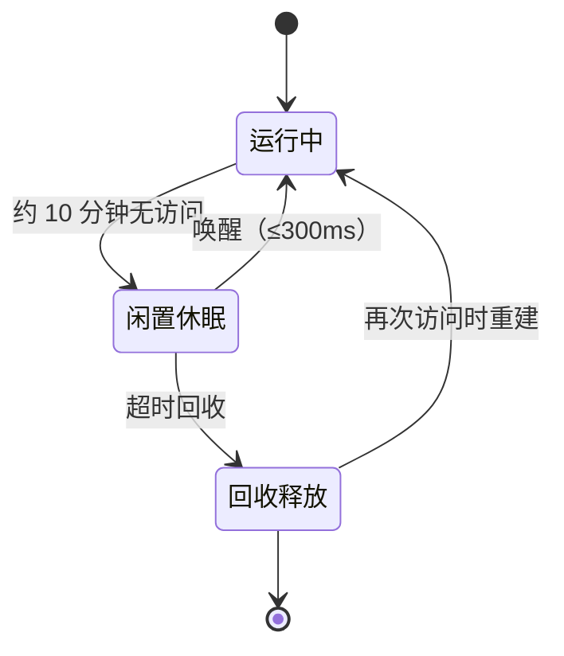
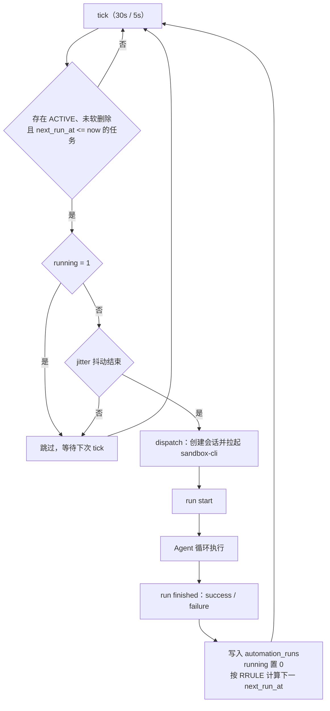
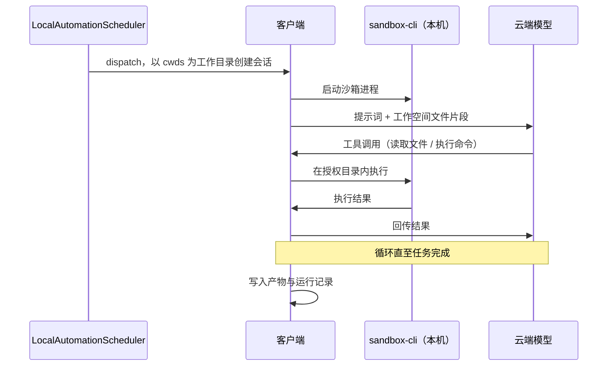

# WorkBuddy 定时任务执行机制

> **适用范围**：WorkBuddy 桌面客户端与 Web 端创建的定时任务（Automation）。
>
> **内容涵盖**：任务创建、调度触发、执行环境、沙箱生命周期、数据存储、资源隔离。
>
> **更新日期**：2026-10-22

---

## 1. 概述

定时任务按创建来源分为三类，机制差异显著：

| 来源     | 执行位置           | 依赖本机在线 | 可访问本地文件 |
| -------- | ------------------ | ------------ | -------------- |
| **本地** | 本机客户端         | 是           | 是             |
| **项目** | 云端沙箱（随项目） | 否           | 否             |
| **云端** | 腾讯云隔离沙箱     | 否           | 否             |

**模式判定**：以创建时"工作空间"字段为依据。指向本地文件夹为本地任务；由系统分配远程空间、或无该字段可选，为云端任务。

**共同点**：项目任务与云端任务均运行在云端沙箱，可归入「云端模式」；本地与云端两种模式的 AI 推理均在云端完成，区别在于脚本执行与文件读写的发生位置。

---

## 2. 能力对比

| 维度                 | 本地任务                             | 云端任务                       |
| -------------------- | ------------------------------------ | ------------------------------ |
| 配置存放             | 本地 SQLite + JSON 快照              | 云端配置库                     |
| 触发机制             | 客户端内轮询调度器                   | 平台统一调度中心               |
| 需开机 / 客户端在线  | 是                                   | 否                             |
| 执行环境             | 本机 `sandbox-cli` 进程              | 云沙箱实例                     |
| 权限配置             | 有（默认 / 完全访问）                | 无                             |
| 可访问本地文件、内网 | 是                                   | 否                             |
| 产物位置             | 本地工作空间文件夹                   | 云端工作空间                   |
| 结束后               | 进程退出，目录与产物留存             | 算力休眠→回收，数据持久        |
| 并发控制             | 本机上限 3 个                        | 平台并发闸门 + 弹性扩容        |
| 推送企业微信         | 支持                                 | 不支持                         |
| 离线时表现           | 不执行，窗口期内补跑                 | 正常执行，仅可查看不可操作     |
| 适用场景             | 本地文件批处理、未上传资料、内网资源 | 轻量任务、跨设备、后台定时运行 |

---

## 3. 云端任务

### 3.1 执行链路


1. **配置入库**：仅写入任务定义（名称、提示词、模型/专家/技能/连接器、执行规则、工作空间、通知渠道），不占用计算资源，未运行时成本近零。
2. **调度触发**：平台统一调度服务扫描到期规则，生成运行实例。
3. **准入校验**：沿用创建者登录身份与积分额度；校验任务启用状态、有效期、频率上限、并发余量与额度。
4. **拉起 Session**：每次运行生成独立会话，携带提示词、云端工作空间文件、项目资产、个人记忆、技能与专家配置。
5. **分配沙箱**：从预热池分配隔离沙箱，将云端工作空间挂载至沙箱文件系统。
6. **执行与回写**：Agent 在沙箱内规划、调用工具、执行脚本、读取文件与连接器；产物写回云端工作空间，运行记录（状态、耗时、摘要、失败原因）入库，并按配置渠道推送。

### 3.2 沙箱生命周期



| 状态     | 资源状态                             | 数据状态           |
| -------- | ------------------------------------ | ------------------ |
| 运行中   | 独占 CPU 与内存配额                  | 产物实时写入持久层 |
| 闲置休眠 | 算力冻结或换出，不计费；进程状态保留 | 持久层不变         |
| 回收释放 | 实例、内存、临时盘归还资源池         | 持久层不变         |

**关键区分**：休眠为暂停与恢复，同一实例，官方指标"唤醒 P95 ≤ 300ms"适用于此阶段；回收后原实例已不存在，再次访问为**重建**（预热池实例 + 预制镜像 + 快照 CoW），速度同样较快但机制不同。

**重建仍快的原因**：

- 会话记录、产物、工作空间均在持久层，与沙箱实例解耦，读取不依赖沙箱
- 沙箱从预制镜像启动，运行时与依赖已内置，无需现场安装
- CoW 写时复制，仅叠加可写增量层，不复制整个文件系统
- 预热池提供已启动实例，免去冷启动

### 3.3 隔离与并发

资源分配规则为 `1 Session : 1 沙箱`，每次运行独占一个沙箱实例与相应配额。

- **共享**：底层物理集群（多租户池化）
- **隔离**：文件系统挂载、进程空间、网络、凭证授权
- **效果**：单个任务异常不波及其他任务

平台级瓶颈位于调度层，整点集中触发时通过并发闸门、弹性扩容与排队消化。

### 3.4 资源与限制

平台侧容量池化，按需横向扩展。公开指标：

- 实例销毁不丢数据（存算分离）
- 秒级 CoW Fork，长任务中断可原地续跑
- 休眠唤醒 P95 ≤ 300ms，闲置不计费
- 单集群百万级 Session，创建速度 ≥ 1 万/秒
- 算力规模从十几至数万节点平滑扩展

单任务侧存在资源配额上限（具体数值未公开）。超限行为：进程被终止，该次运行失败并在运行记录中标注原因，不影响其他任务，下次运行仍从干净沙箱启动。超过最大执行时长同样判定失败。

### 3.5 约束条件

- 编辑时不可选择工作空间与权限
- 不支持推送至企业微信
- 无法访问本机文件、内网、未上传的本地资料
- 提示词中包含本地路径将导致该步骤空跑
- 删除任务后，已产生的云端会话及其产物仍保留
- 手动删除 Session 将永久清除对话记录与文件
- 离线状态仅可查看，不可操作

---

## 4. 本地任务

### 4.1 调度机制

组件为 `LocalAutomationScheduler`，运行于客户端主进程。启动日志参数：

```
[LocalAutomationScheduler] started tickMs=30000 activeTickMs=5000 missedWindowMs=86400000 concurrency=3
```

| 参数             | 值       | 含义                        |
| ---------------- | -------- | --------------------------- |
| `tickMs`         | 30000    | 空闲状态轮询间隔（毫秒）    |
| `activeTickMs`   | 5000     | 有活跃任务时的轮询间隔      |
| `missedWindowMs` | 86400000 | 错过后的补跑窗口（24 小时） |
| `concurrency`    | 3        | 本机并发执行上限            |



**调度特性**：

| 特性 | 说明 |
| --- | --- |
| 物化时间 | `next_run_at` 为预计算时间戳，查询仅需索引扫描 `next_run_at <= now`，不实时解析 cron |
| 抖动（jitter） | 实际启动时间含随机延迟，实测 100830 / 206975 / 516426 ms（约 1.7～8.6 分钟），用于规避整点集中触发 |
| 休眠暂停 | 系统休眠或锁屏触发 `scheduling suspended`，恢复后 `scheduling resumed`；窗口期内补跑，超期判定错过 |
| 启动对账 | 客户端启动时回收标记为运行中但已中断的记录（`reconciled N/N in-progress automation run records`），避免 `running` 长期卡死 |
| 时区 | RRULE 的 `BYHOUR` 按本地时区解释，入库 `next_run_at` 为 epoch 毫秒 |

### 4.2 执行进程模型



沙箱进程路径：

```
/Applications/WorkBuddy.app/Contents/Resources/app.asar.unpacked/cli/vendor/sandbox/<version>/sandbox-cli
```

每会话一个沙箱进程，落盘目录 `~/.workbuddy/workspace/sessions/<session_id>/`，包含：

| 子目录 / 文件     | 内容             |
| ----------------- | ---------------- |
| `fs/`             | 会话文件系统视图 |
| `snapfile/`       | 快照             |
| `permission.json` | 本会话权限策略   |
| `modify_backup/`  | 改动前备份       |

权限判定逐次执行，依据 `permission.json`；`permission_mode=fullAccess` 时全部放行。

### 4.3 数据存储

存储分三层：配置与状态存 SQLite，产物存普通文件夹，过程存日志。

| 数据类别     | 位置                                                     | 形态         |
| ------------ | -------------------------------------------------------- | ------------ |
| 任务定义     | `~/.workbuddy/workbuddy.db` → `automations`              | SQLite       |
| 运行记录     | 同库 → `automation_runs`                                 | SQLite       |
| 防重入状态   | 同库 → `automation_runtime_state`                        | SQLite       |
| 推送队列     | 同库 → `automation_delivery_outbox`                      | SQLite       |
| 任务快照     | `~/.workbuddy/automation-backups/automation-*.json`      | JSON         |
| **产物**     | **`cwds` 指向的本地文件夹**                                | **普通文件** |
| 会话沙箱痕迹 | `~/.workbuddy/workspace/sessions/<session_id>/`          | 目录         |
| 调度日志     | `~/.workbuddy/logs/automation.log`                       | 文本         |
| 沙箱日志     | `~/.workbuddy/logs/sandbox/<date>/sandbox_<pid>_000.log` | 文本         |

主库为 WAL 模式（伴随 `-wal` / `-shm`）。产物为普通文件，可脱离 WorkBuddy 直接访问，支持版本管理与外部同步。

### 4.4 数据库表结构

`automations` —— 任务定义

```sql
id, name, prompt, status, schedule_type,
next_run_at, last_run_at,        -- next_run_at 为预计算触发时间（epoch ms）
cwds,                            -- JSON 数组，本地工作目录
rrule, scheduled_at, valid_from, valid_until,
model_id, model_is_thinking, skills_json,
push_to_wechat, push_to_wecom_bot, wecom_bot_source,
owner_user_id, owner_status, owner_source,
expert_id, expert_marketplace, connector_ids_json,
permission_mode, created_at, updated_at, deleted_at
```

增量字段：`workspace_scope`、`context_window`、`reasoning_effort`、`wecom_bot_chat_id`。`deleted_at` 表示软删除，记录保留但不再参与调度。

`automation_runs` —— 单次运行

```sql
thread_id(主键), automation_id, status, read_at, thread_title,
source_cwd, runs_json, result_success, metadata_json,
failure_code, reason_code, created_at, updated_at
```

`automation_runtime_state` —— 防重入

```sql
automation_id(主键), last_run_at, last_error,
running, running_started_at, running_conversation_id, metadata_json
```

`running` 用于防止同一任务并发执行。

`automation_delivery_outbox` —— 推送投递（事务性发件箱）

```sql
dedupe_key(唯一), channel, automation_id, run_id, payload_json,
status, attempt_count, max_attempts(默认 5),
next_run_at, lease_owner, lease_expire_at,
last_error_code, last_error_message, delivery_id
```

推送失败不影响任务执行，由该表带租约重试，上限 5 次。

### 4.5 生命周期与清理

任务结束后：执行进程退出，不常驻；产物与运行记录留存；会话沙箱目录保留（用于回溯会话、回滚改动），由用户手动清理。

本地任务不存在池化回收机制，无"归还资源池"过程。清理行为仅有两类：

| 清理对象     | 触发方式                               |
| ------------ | -------------------------------------- |
| 会话沙箱目录 | 用户删除会话或手动清理                 |
| 自动备份     | 备份空间达上限后按时间顺序清理最早快照 |

**异常挂起**：默认权限下遇到需确认的操作，无人响应时任务停留在等待确认状态，不自动终止、不消耗资源。

---

## 5. 关键差异对照

| 问题             | 本地任务                        | 云端任务                                 |
| ---------------- | ------------------------------- | ---------------------------------------- |
| 执行环境位置     | 本机 `sandbox-cli` 进程         | 云弹性算力池中的隔离沙箱                 |
| 结束后是否销毁   | 进程退出；会话目录与产物留存    | 算力休眠后回收；数据在持久层不丢         |
| 二次访问是否快速 | 是，会话目录在本地磁盘          | 是，预热实例 + 镜像 + CoW 快照重建       |
| 是否共享执行环境 | 否，进程级隔离，本机上限 3 并发 | 否，`1 Session : 1 沙箱`，仅共享物理集群 |
| 资源不足表现     | 占用本机内存，影响本机性能      | 单沙箱配额超限即失败，不影响其他任务     |
| 数据存放         | SQLite 四表 + 本地文件夹        | 云端持久层 + 云端工作空间                |
| 本机离线影响     | 不执行，24 小时窗口内补跑       | 无影响                                   |

---

## 6. 资料可信度说明

| 级别 | 范围 |
| --- | --- |
| **A：产品文档明示** | 三种任务来源、配置项定义、云端沙箱隔离与免开机、"任务频率 / 最大执行时长 / 系统并发"限制、云端任务不支持企业微信推送且无法访问本地文件、任务删除后云端会话保留、Session 闲置 10 分钟休眠与唤醒、删除 Session 永久清除、`1 Session : 1 沙箱`、存算分离、秒级 CoW Fork、中断续跑、闲置不计费、百万级并发与预热池 |
| **B：本机实测（2026-10-21）** | 数据库文件位置与四表字段、调度器四项参数、jitter 实测值、`sandbox-cli` 路径、会话沙箱目录结构、JSON 快照字段、日志格式 |
| **C：机制推断** | 单沙箱内存配额数值、回收超时阈值、镜像与快照的实现细节、云端调度扫描间隔 |

C 级内容用于解释行为，不作为规格参数引用。

**参考文档**

- 定时任务：`https://www.workbuddy.cn/docs/workbuddy/From-Beginner-to-Expert-Guide/Function-Description/Automation-Guide`
- 项目管理（本地/云端任务对比、项目存储 5GB）：`https://cloud.tencent.cn/document/product/1759/138797`
- WorkBuddy Managed Agents（运行底座）：`https://www.workbuddy.cn/docs/enterprise/216050766183768064`
