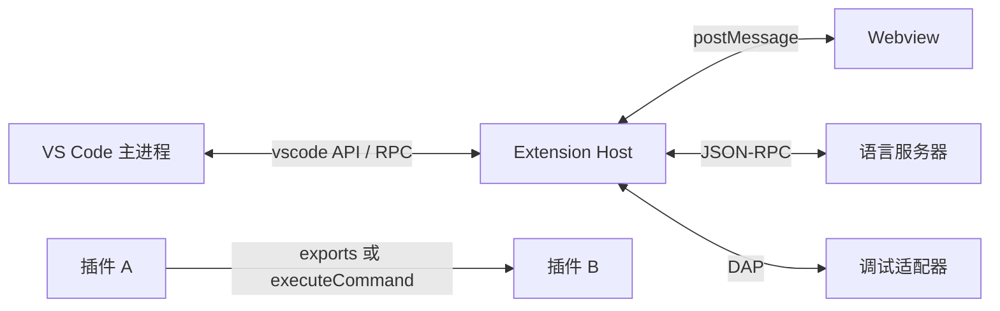

# VS Code 插件通信方式

插件跑在独立的 **Extension Host**（Node 进程；远程开发时在远端，网页版扩展在 Worker 里）。主进程负责窗口和编辑器。两边不共享对象，所有 `vscode.*` 调用都经 RPC 转到主进程，事件再从主进程推回来。

插件和插件之间没有独立的消息总线。同一 Host 内用 `activate` 返回的 API；跨 Host 用命令。其余数据借配置、诊断、文件、认证、任务这些 VS Code 能力中转。



下文示例里的扩展 ID、命令 ID 使用 `demo`、`publisher.math` 作为占位。片段默认写在 `activate(context)` 里。

## 总表

| 方向 | 方式 | 数据怎么走 |
| --- | --- | --- |
| 插件 → VS Code | `vscode` API | RPC 请求 |
| VS Code → 插件 | 事件、`activate`、Provider 回调、命令回调 | RPC 回调 |
| 安装期约定 | `package.json` 的 `contributes` | VS Code 读清单后挂菜单、视图、配置 |
| 插件 ↔ 页面 | Webview / Notebook `postMessage` | 结构化克隆 |
| 插件 ↔ 子进程 | LSP、DAP、伪终端、MCP stdio | JSON-RPC 或字节流 |
| 外部程序 → 插件 | URI Handler | `vscode://publisher.name/...` |
| 插件 ↔ 插件（同 Host） | `exports` | 直接调用返回的函数和事件 |
| 插件 ↔ 插件（可跨 Host） | `executeCommand` | 参数需可序列化 |
| 插件 ↔ 插件（间接） | 配置、Context Key、诊断、文件、虚拟文档、文件系统、认证、任务、调试、Chat Tool、MCP | 经 VS Code 中转 |

---

## 一、插件和 VS Code

### 1. `vscode` API

方向：插件发起调用，主进程执行并返回结果。窗口、工作区、语言、调试、任务都走这一条。

```typescript
import * as vscode from 'vscode';

export function activate(context: vscode.ExtensionContext) {
  // 弹窗、状态栏、打开文档，都是发往主进程的请求
  const item = vscode.window.createStatusBarItem(vscode.StatusBarAlignment.Left, 100);
  item.text = '$(pulse) demo';
  item.command = 'demo.hello';
  item.show();
  context.subscriptions.push(item);

  void vscode.window.showInformationMessage('插件已激活');
}
```

远程场景下，UI 扩展跑在本地 Host，工作区扩展跑在远端 Host。`package.json` 用 `extensionKind` 声明：

```json
{
  "extensionKind": ["workspace"]
}
```

`"ui"` 表示跟随界面，`"workspace"` 表示跟随打开的文件夹。

### 2. 贡献点

方向：VS Code 在激活前读取 `package.json`，先把命令、菜单、视图、语言、配置挂上。用户触发后才调用 `activate`。

```json
{
  "name": "demo",
  "publisher": "publisher",
  "engines": { "vscode": "^1.95.0" },
  "main": "./out/extension.js",
  "activationEvents": [],
  "contributes": {
    "commands": [
      { "command": "demo.hello", "title": "Demo: Hello" }
    ],
    "menus": {
      "commandPalette": [
        { "command": "demo.hello" }
      ]
    },
    "views": {
      "explorer": [
        { "id": "demo.tree", "name": "Demo" }
      ]
    },
    "configuration": {
      "title": "Demo",
      "properties": {
        "demo.intervalMs": {
          "type": "number",
          "default": 1000,
          "minimum": 200,
          "description": "刷新间隔（毫秒）"
        }
      }
    }
  }
}
```

写进 `contributes.commands` 的命令会自动带上 `onCommand` 激活。`activationEvents` 可以留空。只有代码里 `registerCommand`、清单里没声明的命令，需要调用方另外保证扩展已经激活。

常见贡献点还有：`keybindings`、`viewsContainers`、`languages`、`grammars`、`snippets`、`themes`、`debuggers`、`taskDefinitions`、`problemMatchers`、`customEditors`、`notebooks`、`authentication`、`chatParticipants`、`languageModelTools`、`mcpServerDefinitionProviders`。

### 3. 激活和销毁

方向：VS Code 调用 `activate`，关闭或禁用时调用 `deactivate`。`ExtensionContext` 是插件拿存储、路径和订阅列表的入口。

```typescript
import * as vscode from 'vscode';

export function activate(context: vscode.ExtensionContext) {
  // 放进 subscriptions 的对象会在扩展卸载时 dispose
  context.subscriptions.push(
    vscode.commands.registerCommand('demo.hello', () => {
      void vscode.window.showInformationMessage('hello');
    })
  );
}

export function deactivate() {
  // 停掉这里没放进 subscriptions 的定时器和子进程
}
```

激活要短。读大目录、连网、拉起语言服务器放到第一次真正用到时，或放进 `setTimeout` / 已有的懒加载路径。

### 4. Provider：VS Code 回调插件

方向：插件先注册，VS Code 在补全、展开树、读文件时回调。

语言功能用文档选择器限定语言和 scheme。补全、悬停、定义、引用、代码操作、格式化、语义高亮、代码镜头都是同一模式：`registerXxxProvider(selector, provider)`。

```typescript
import * as vscode from 'vscode';

const selector: vscode.DocumentSelector = { language: 'demo', scheme: 'file' };

context.subscriptions.push(
  vscode.languages.registerCompletionItemProvider(selector, {
    provideCompletionItems(document, position) {
      const item = new vscode.CompletionItem('demoItem');
      item.insertText = 'demoItem()';
      return [item];
    },
  })
);
```

树视图：插件推 `onDidChangeTreeData`，VS Code 再拉 `getChildren` / `getTreeItem`。

```typescript
import * as vscode from 'vscode';

interface DemoNode {
  label: string;
}

class DemoTree implements vscode.TreeDataProvider<DemoNode> {
  private readonly emitter = new vscode.EventEmitter<DemoNode | undefined>();
  readonly onDidChangeTreeData = this.emitter.event;

  getTreeItem(element: DemoNode): vscode.TreeItem {
    return new vscode.TreeItem(element.label);
  }

  getChildren(): DemoNode[] {
    return [{ label: 'item' }];
  }

  refresh(): void {
    this.emitter.fire(undefined);
  }
}

const tree = new DemoTree();
context.subscriptions.push(
  vscode.window.createTreeView('demo.tree', { treeDataProvider: tree })
);
```

虚拟文档：给一个自定义 scheme 提供只读文本，其他插件用 `workspace.openTextDocument` 打开。

```typescript
import * as vscode from 'vscode';

const scheme = 'demo';
context.subscriptions.push(
  vscode.workspace.registerTextDocumentContentProvider(scheme, {
    provideTextDocumentContent(uri) {
      return `内容来自 ${uri.path}`;
    },
  })
);

const uri = vscode.Uri.parse('demo:/hello');
const doc = await vscode.workspace.openTextDocument(uri);
await vscode.window.showTextDocument(doc);
```

文件系统：把一组资源挂成 `workspace.fs` 能读写的 scheme。只读演示实现了 `stat`、`readDirectory`、`readFile`，可写还要实现 `writeFile`、`delete`、`rename`、`createDirectory`，监听变化要实现 `watch` 并触发 `onDidChangeFile`。

```typescript
import * as vscode from 'vscode';

const encoder = new TextEncoder();

context.subscriptions.push(
  vscode.workspace.registerFileSystemProvider('mem', {
    onDidChangeFile: new vscode.EventEmitter<vscode.FileChangeEvent[]>().event,
    watch: () => new vscode.Disposable(() => undefined),
    stat: () => ({
      type: vscode.FileType.File,
      ctime: 0,
      mtime: 0,
      size: 5,
    }),
    readDirectory: () => [['hello.txt', vscode.FileType.File]],
    readFile: () => encoder.encode('hello'),
    writeFile: () => undefined,
    delete: () => undefined,
    rename: () => undefined,
    createDirectory: () => undefined,
  }, { isReadonly: true })
);
```

### 5. 事件：VS Code 推给插件

方向：主进程在文档、配置、编辑器、调试变化时通知插件。监听返回值放进 `subscriptions`。

```typescript
import * as vscode from 'vscode';

context.subscriptions.push(
  vscode.window.onDidChangeActiveTextEditor((editor) => {
    console.log(editor?.document.uri.toString());
  }),
  vscode.workspace.onDidChangeTextDocument((event) => {
    console.log(event.document.uri.toString(), event.contentChanges.length);
  }),
  vscode.workspace.onDidChangeConfiguration((event) => {
    // 只处理自己的配置，避免每次设置变化都重算
    if (event.affectsConfiguration('demo.intervalMs')) {
      const interval = vscode.workspace.getConfiguration('demo').get<number>('intervalMs', 1000);
      console.log(interval);
    }
  }),
  vscode.debug.onDidStartDebugSession((session) => {
    console.log(session.name);
  })
);
```

### 6. 命令

方向是双向的。用户从菜单、快捷键、命令面板点进来，插件用 `executeCommand` 调 VS Code 内置命令或其他插件的命令。

`registerCommand` 的参数就是调用时传入的参数。`registerTextEditorCommand` 额外带上当前编辑器和 `TextEditorEdit`。

```typescript
import * as vscode from 'vscode';

context.subscriptions.push(
  vscode.commands.registerCommand('demo.hello', async (name?: string) => {
    void vscode.window.showInformationMessage(`hello ${name ?? 'world'}`);
    return name ?? 'world';
  }),
  vscode.commands.registerTextEditorCommand('demo.insert', (editor, edit) => {
    edit.insert(editor.selection.active, 'demo');
  })
);

// 调用自己或别人的命令；内置命令如 workbench.action.files.save
const result = await vscode.commands.executeCommand<string>('demo.hello', 'VS Code');
```

命令链接把参数放在 query 的 JSON 数组里，菜单和 Webview 里都能用：

```typescript
const args = encodeURIComponent(JSON.stringify(['VS Code']));
const link = vscode.Uri.parse(`command:demo.hello?${args}`);
```

### 7. Webview

方向：扩展宿主和 Webview 页面互相 `postMessage`。消息走结构化克隆，函数、`undefined` 字段、DOM 节点过不去。本地资源要用 `asWebviewUri`，并用随机 nonce 收紧 CSP。

```typescript
import * as vscode from 'vscode';

const panel = vscode.window.createWebviewPanel(
  'demo',
  'Demo',
  vscode.ViewColumn.One,
  { enableScripts: true, localResourceRoots: [context.extensionUri] }
);

const nonce = String(Math.random()).slice(2);
const scriptUri = panel.webview.asWebviewUri(
  vscode.Uri.joinPath(context.extensionUri, 'media', 'main.js')
);

panel.webview.html = `<!DOCTYPE html>
<html>
<body>
  <script nonce="${nonce}" src="${scriptUri}"></script>
</body>
</html>`;

// 插件 → 页面
void panel.webview.postMessage({ type: 'update', text: 'hi' });

// 页面 → 插件
context.subscriptions.push(
  panel.webview.onDidReceiveMessage((message: { type: string }) => {
    if (message.type === 'ready') {
      void panel.webview.postMessage({ type: 'update', text: 'ready' });
    }
  }),
  panel
);
```

页面对应脚本：

```javascript
const vscodeApi = acquireVsCodeApi();
vscodeApi.postMessage({ type: 'ready' });
window.addEventListener('message', (event) => {
  console.log(event.data);
});
```

侧边栏用 `window.registerWebviewViewProvider`，通信对象同样是 `webview.postMessage` / `onDidReceiveMessage`。编辑器区面板销毁后要重新 `createWebviewPanel`；`retainContextWhenHidden: true` 会把隐藏的页面留在内存里。

### 8. Notebook 渲染器消息

方向：扩展宿主和 Notebook 输出渲染器之间。渲染器 ID 与 `contributes.notebookRenderer` 一致。

```typescript
import * as vscode from 'vscode';

const messaging = vscode.notebooks.createRendererMessaging('demo-renderer');

context.subscriptions.push(
  messaging.onDidReceiveMessage((event) => {
    // event.editor 是当前笔记本，event.message 是渲染器发来的数据
    console.log(event.message);
  })
);

await messaging.postMessage({ type: 'refresh' });
```

### 9. 状态、密钥、配置

这三处都由 VS Code 落盘或放进系统密钥链。`globalState` 按扩展隔离，跟用户走；`workspaceState` 跟工作区走。令牌放 `secrets`。

```typescript
import * as vscode from 'vscode';

await context.globalState.update('count', 1);
const count = context.globalState.get<number>('count', 0);

await context.workspaceState.update('lastUri', vscode.window.activeTextEditor?.document.uri.toString());

await context.secrets.store('token', 'secret');
const token = await context.secrets.get('token');

const config = vscode.workspace.getConfiguration('demo');
const interval = config.get<number>('intervalMs', 1000);
await config.update('intervalMs', interval, vscode.ConfigurationTarget.Global);
```

多根工作区、语言覆盖配置时，`getConfiguration` 传入当前文档 URI，才能读到文件夹和语言级别的值：

```typescript
const folderConfig = vscode.workspace.getConfiguration(
  'demo',
  vscode.window.activeTextEditor?.document.uri
);
```

### 10. URI Handler

方向：外部程序打开 `vscode://publisher.name/路径?查询`，VS Code 把 URI 交给对应扩展。`publisher.name` 必须是扩展 ID。

```typescript
import * as vscode from 'vscode';

context.subscriptions.push(
  vscode.window.registerUriHandler({
    handleUri(uri: vscode.Uri) {
      // 例如 vscode://publisher.demo/open?file=a.ts
      void vscode.window.showInformationMessage(uri.path + uri.query);
    },
  })
);
```

清单里声明 `onUri` 后，收到这种链接会激活扩展。贡献了 URI Handler 时，这个激活事件会自动生成。

### 11. 语言服务器（LSP）

方向：扩展宿主拉起语言服务器进程，双方用 JSON-RPC（stdio 或 IPC）。VS Code 的补全、诊断由扩展侧的语言客户端翻译成 `vscode` API。

扩展侧：

```typescript
import * as vscode from 'vscode';
import {
  LanguageClient,
  TransportKind,
  type LanguageClientOptions,
  type ServerOptions,
} from 'vscode-languageclient/node';

const serverModule = context.asAbsolutePath('out/server.js');
const serverOptions: ServerOptions = {
  run: { module: serverModule, transport: TransportKind.ipc },
  debug: { module: serverModule, transport: TransportKind.ipc },
};
const clientOptions: LanguageClientOptions = {
  documentSelector: [{ scheme: 'file', language: 'demo' }],
};

const client = new LanguageClient('demo', 'Demo Language Server', serverOptions, clientOptions);
context.subscriptions.push(client.start());
```

服务器侧：

```typescript
import { createConnection, TextDocuments, ProposedFeatures } from 'vscode-languageserver/node';
import { TextDocument } from 'vscode-languageserver-textdocument';

const connection = createConnection(ProposedFeatures.all);
const documents = new TextDocuments(TextDocument);

connection.onInitialize(() => ({
  capabilities: {
    textDocumentSync: 1,
  },
}));

documents.listen(connection);
connection.listen();
```

### 12. 调试适配器（DAP）

方向：VS Code 调试服务向插件要适配器描述，然后和适配器进程说 DAP。插件负责把两边接上。

```typescript
import * as vscode from 'vscode';

context.subscriptions.push(
  vscode.debug.registerDebugConfigurationProvider('demo', {
    resolveDebugConfiguration(_folder, config) {
      if (!config.type) {
        config.type = 'demo';
        config.request = 'launch';
        config.name = 'Debug Demo';
      }
      return config;
    },
  }),
  vscode.debug.registerDebugAdapterDescriptorFactory('demo', {
    createDebugAdapterDescriptor() {
      // 也可以返回 DebugAdapterServer，或 DebugAdapterInlineImplementation
      return new vscode.DebugAdapterExecutable('node', [
        context.asAbsolutePath('out/debugAdapter.js'),
      ]);
    },
  })
);
```

`package.json` 里用 `contributes.debuggers` 声明 `type`，调试面板才能列出这种配置。

### 13. 伪终端

方向：VS Code 把终端的输入交给 `handleInput`，插件用 `onDidWrite` 把输出画回去。`\r\n` 才是终端换行。

```typescript
import * as vscode from 'vscode';

const writeEmitter = new vscode.EventEmitter<string>();
const pty: vscode.Pseudoterminal = {
  onDidWrite: writeEmitter.event,
  open() {
    writeEmitter.fire('demo terminal\r\n');
  },
  close() {
    writeEmitter.dispose();
  },
  handleInput(data: string) {
    writeEmitter.fire(data === '\r' ? '\r\n' : data);
  },
};

const terminal = vscode.window.createTerminal({ name: 'Demo', pty });
terminal.show();
context.subscriptions.push(terminal);
```

普通终端是另一条路：`createTerminal({ shellPath })` 由 VS Code 启动真实 shell。`context.environmentVariableCollection` 用来给后续终端注入环境变量。

### 14. 认证

方向：插件注册认证提供者，VS Code 在登录、刷新、退出时回调。其他插件通过 `authentication.getSession` 取会话，双方不直接互相引用。

```typescript
import * as vscode from 'vscode';

class DemoAuth implements vscode.AuthenticationProvider {
  private readonly emitter = new vscode.EventEmitter<vscode.AuthenticationProviderAuthenticationSessionsChangeEvent>();
  readonly onDidChangeSessions = this.emitter.event;
  private sessions: vscode.AuthenticationSession[] = [];

  async getSessions(): Promise<vscode.AuthenticationSession[]> {
    return this.sessions;
  }

  async createSession(scopes: string[]): Promise<vscode.AuthenticationSession> {
    const session: vscode.AuthenticationSession = {
      id: '1',
      accessToken: 'token',
      account: { id: 'user', label: 'User' },
      scopes,
    };
    this.sessions = [session];
    this.emitter.fire({ added: [session], removed: [], changed: [] });
    return session;
  }

  async removeSession(sessionId: string): Promise<void> {
    const removed = this.sessions.filter((item) => item.id === sessionId);
    this.sessions = this.sessions.filter((item) => item.id !== sessionId);
    this.emitter.fire({ added: [], removed, changed: [] });
  }
}

context.subscriptions.push(
  vscode.authentication.registerAuthenticationProvider('demo', 'Demo', new DemoAuth(), {
    supportsMultipleAccounts: false,
  })
);

const session = await vscode.authentication.getSession('demo', ['read'], { createIfNone: true });
```

清单里同时声明 `contributes.authentication`，ID 与 `registerAuthenticationProvider` 的第一个参数一致。访问令牌放 `context.secrets`，会话列表可以放 `globalState`。

### 15. 任务

方向：插件用 `TaskProvider` 交出任务，VS Code 在运行任务时来取。其他插件可以用 `fetchTasks` / `executeTask` 跑这些任务。

```json
{
  "contributes": {
    "taskDefinitions": [
      { "type": "demo", "properties": {} }
    ]
  }
}
```

```typescript
import * as vscode from 'vscode';

context.subscriptions.push(
  vscode.tasks.registerTaskProvider('demo', {
    provideTasks() {
      return [
        new vscode.Task(
          { type: 'demo' },
          vscode.TaskScope.Workspace,
          'echo',
          'demo',
          new vscode.ShellExecution('echo hello')
        ),
      ];
    },
    resolveTask(task) {
      return task;
    },
  })
);

const tasks = await vscode.tasks.fetchTasks({ type: 'demo' });
if (tasks[0]) {
  await vscode.tasks.executeTask(tasks[0]);
}
```

### 16. Chat、Language Model Tool、MCP

这三条都是插件把能力交给 VS Code 的 AI 面，由聊天或 Agent 发起调用。

Chat 参与者处理 `@demo` 这种对话：

```json
{
  "contributes": {
    "chatParticipants": [
      {
        "id": "demo.chat",
        "name": "demo",
        "description": "演示参与者"
      }
    ]
  }
}
```

```typescript
import * as vscode from 'vscode';

const participant = vscode.chat.createChatParticipant('demo.chat', async (request, _context, stream) => {
  stream.markdown(`收到：${request.prompt}`);
  return {};
});
context.subscriptions.push(participant);
```

Language Model Tool 是扩展内的工具。`name` 要和 `registerTool` 一致。

```json
{
  "contributes": {
    "languageModelTools": [
      {
        "name": "demo_echo",
        "displayName": "Echo",
        "modelDescription": "把传入文本原样返回",
        "inputSchema": {
          "type": "object",
          "properties": {
            "text": { "type": "string", "description": "要回显的文本" }
          },
          "required": ["text"]
        }
      }
    ]
  }
}
```

```typescript
import * as vscode from 'vscode';

interface EchoInput {
  text: string;
}

class EchoTool implements vscode.LanguageModelTool<EchoInput> {
  async invoke(options: vscode.LanguageModelToolInvocationOptions<EchoInput>) {
    return new vscode.LanguageModelToolResult([
      new vscode.LanguageModelTextPart(options.input.text),
    ]);
  }
}

context.subscriptions.push(vscode.lm.registerTool('demo_echo', new EchoTool()));
```

MCP 服务器跑在独立进程或 HTTP 端点上，VS Code 按 MCP 协议发现工具。提供者 ID 两边要一致。

```json
{
  "contributes": {
    "mcpServerDefinitionProviders": [
      { "id": "demoProvider", "label": "Demo MCP" }
    ]
  }
}
```

```typescript
import * as vscode from 'vscode';

const didChange = new vscode.EventEmitter<void>();

context.subscriptions.push(
  vscode.lm.registerMcpServerDefinitionProvider('demoProvider', {
    onDidChangeMcpServerDefinitions: didChange.event,
    provideMcpServerDefinitions() {
      return [
        new vscode.McpStdioServerDefinition({
          label: 'demoServer',
          command: 'node',
          args: [context.asAbsolutePath('out/mcpServer.js')],
          cwd: context.extensionUri,
          version: '1.0.0',
        }),
      ];
    },
    resolveMcpServerDefinition(server) {
      // 启动前可以在这里补环境变量或做登录
      return server;
    },
  }),
  didChange
);
```

用户目录下的 `.vscode/mcp.json` 是另一条注册路径，不经过扩展 API。

---

## 二、插件和插件

### 1. `activate` 的返回值

同一 Extension Host 内，提供方从 `activate` 返回对象，调用方用 `extensions.getExtension` 拿到它。对象里可以是函数，也可以是 `Event`。

`package.json` 写上依赖后，依赖会先激活，且用户没装依赖时会提示安装：

```json
{
  "extensionDependencies": ["publisher.math"]
}
```

提供方 `publisher.math`：

```typescript
import * as vscode from 'vscode';

export interface MathApi {
  mul(a: number, b: number): number;
  onDidCalculate: vscode.Event<number>;
}

export function activate(): MathApi {
  const emitter = new vscode.EventEmitter<number>();
  return {
    mul(a, b) {
      const value = a * b;
      emitter.fire(value);
      return value;
    },
    onDidCalculate: emitter.event,
  };
}
```

调用方：

```typescript
import * as vscode from 'vscode';
import type { MathApi } from './mathApi';

export async function activate(context: vscode.ExtensionContext) {
  const math = vscode.extensions.getExtension<MathApi>('publisher.math');
  if (!math) {
    return;
  }

  // 依赖尚未激活时 activate() 会先激活它，并返回同一份 exports
  const api = math.isActive ? math.exports : await math.activate();
  context.subscriptions.push(api.onDidCalculate((value) => console.log(value)));
  console.log(api.mul(6, 7));
}
```

`extensions.all` 和 `getExtension` 只包含当前 Host 里的扩展。本地 UI 扩展拿不到远端工作区扩展的 `exports`。`extensions.onDidChange` 在安装、禁用变化时触发。

### 2. 命令

命令可以跨 Extension Host。提供方注册命令，调用方 `executeCommand`。对方若在清单里贡献了该命令，调用时会把它激活。

提供方：

```typescript
import * as vscode from 'vscode';

export function activate(context: vscode.ExtensionContext) {
  context.subscriptions.push(
    vscode.commands.registerCommand('math.mul', (a: number, b: number) => a * b)
  );
}
```

调用方：

```typescript
import * as vscode from 'vscode';

const value = await vscode.commands.executeCommand<number>('math.mul', 6, 7);
const commandIds = await vscode.commands.getCommands(true);
```

跨 Host 时参数和返回值使用字符串、数字、布尔、`null`，以及 `Uri`、`Position`、`Range`、`Location`。同一 Host 里、命令就注册在本进程时，可以传扩展自己的对象。

只给其他插件用、不出现在命令面板的命令，仍然要在 `contributes.commands` 里声明，这样 `onCommand` 激活才存在。再用菜单的 `when` 把它从面板里藏掉，或接受它出现在面板中。

### 3. 经 VS Code 中转

双方约定同一个键、同一种文件或同一种任务类型。

配置。一方写入，另一方听 `onDidChangeConfiguration`：

```typescript
import * as vscode from 'vscode';

await vscode.workspace.getConfiguration('demo').update('intervalMs', 500, vscode.ConfigurationTarget.Workspace);

context.subscriptions.push(
  vscode.workspace.onDidChangeConfiguration((event) => {
    if (event.affectsConfiguration('demo.intervalMs')) {
      const interval = vscode.workspace.getConfiguration('demo').get<number>('intervalMs', 1000);
      console.log(interval);
    }
  })
);
```

Context Key。`setContext` 写入后，其他扩展的菜单 `when` 能读到。它适合控制按钮显隐，不适合传业务对象。

```typescript
import * as vscode from 'vscode';

await vscode.commands.executeCommand('setContext', 'demo.hasSelection', true);
```

```json
{
  "menus": {
    "editor/context": [
      {
        "command": "demo.hello",
        "when": "demo.hasSelection"
      }
    ]
  }
}
```

诊断。写入诊断集合后，任何插件都能按 URI 读到。

```typescript
import * as vscode from 'vscode';

const collection = vscode.languages.createDiagnosticCollection('demo');
const uri = vscode.Uri.file('/tmp/demo.txt');
collection.set(uri, [
  new vscode.Diagnostic(
    new vscode.Range(0, 0, 0, 1),
    'demo warning',
    vscode.DiagnosticSeverity.Warning
  ),
]);

const diagnostics = vscode.languages.getDiagnostics(uri);
context.subscriptions.push(collection);
```

文件。一方写文件，另一方监视。

```typescript
import * as vscode from 'vscode';

const folder = vscode.workspace.workspaceFolders?.[0];
if (folder) {
  const uri = vscode.Uri.joinPath(folder.uri, '.demo', 'message.json');
  await vscode.workspace.fs.writeFile(uri, Buffer.from(JSON.stringify({ text: 'hi' })));

  const watcher = vscode.workspace.createFileSystemWatcher(
    new vscode.RelativePattern(folder, '.demo/message.json')
  );
  context.subscriptions.push(
    watcher,
    watcher.onDidChange(async (changed) => {
      const bytes = await vscode.workspace.fs.readFile(changed);
      console.log(Buffer.from(bytes).toString('utf8'));
    })
  );
}
```

虚拟文档和自定义文件系统见上文第 4 节。提供方注册 scheme 之后，调用方打开 `demo:/hello` 或用 `workspace.fs.readFile(vscode.Uri.parse('mem:/hello.txt'))`。

认证会话见上文第 14 节。提供者注册 `demo`，调用方执行：

```typescript
const session = await vscode.authentication.getSession('demo', ['read'], { createIfNone: false });
```

任务见上文第 15 节。调用方按 `type` 拉取并执行。调试类型同理，调用方提交一种对方贡献的配置：

```typescript
import * as vscode from 'vscode';

const folder = vscode.workspace.workspaceFolders?.[0];
await vscode.debug.startDebugging(folder, {
  type: 'demo',
  request: 'launch',
  name: 'Debug Demo',
});
```

Chat Tool 和 MCP 由 VS Code 的聊天面调用，其他扩展不直接拿函数引用。工具名、MCP 提供者 ID 是双方的约定。

`extensionPack` 只把多个扩展一起安装，不传递数据：

```json
{
  "extensionPack": ["publisher.math", "publisher.demo"]
}
```

每个扩展的 `globalState` 和 `secrets` 按扩展 ID 分开存放。

---

## 三、怎么选

| 场景 | 用哪条 |
| --- | --- |
| 改界面、读文档、弹窗、注册语言功能 | `vscode` API 和对应 Provider |
| 菜单、配置、主题在激活前就要出现 | `contributes` |
| 自定义 HTML 界面 | Webview `postMessage` |
| 语言分析要单独进程 | LSP |
| 调试器 | DAP |
| 同一窗口里给别的插件提供函数或事件 | `activate` 返回 API，并写 `extensionDependencies` |
| 跨本地/远程 Host，或希望命令面板也能用 | `registerCommand` + `executeCommand` |
| 同步一个用户可见的开关 | 配置 |
| 控制别人的菜单是否出现 | `setContext` |
| 把问题列表公开出去 | 诊断集合 |
| 没有稳定 API、只需要松耦合 | 工作区文件 + `FileSystemWatcher` |
| 共享登录态 | Authentication Provider + `getSession` |
| 让别人跑你的命令行步骤 | Task Provider |
| 把工具交给 Agent | Language Model Tool 或 MCP |

---

## 四、边界

- `exports` 只在同一个 Extension Host 里可用。本地和远程之间用命令。
- 跨 Host 的命令参数使用可 JSON 序列化的值，以及 `Uri`、`Position`、`Range`、`Location`。
- 插件代码不能把函数交给 Webview，也不能在扩展里操作 DOM。
- `globalState`、`workspaceState`、`secrets` 都带扩展 ID，其他插件读不到。
- VS Code 没有官方的跨插件事件总线。事件要么放在 `exports` 里，要么退化成命令或文件监视。
